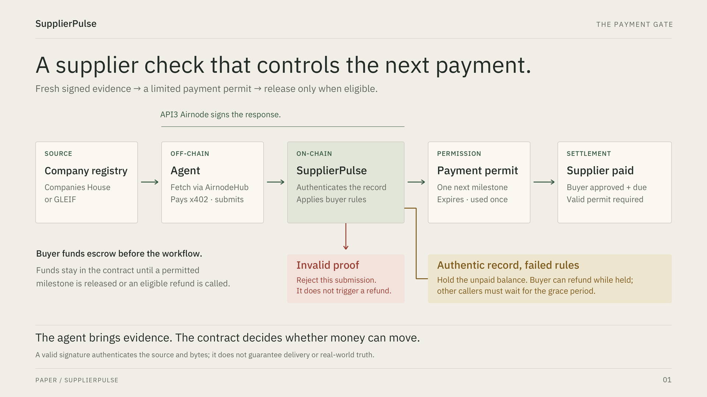
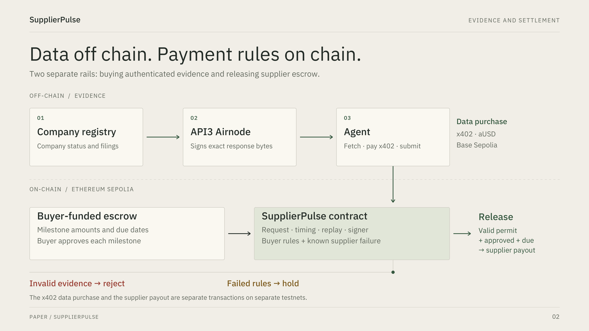
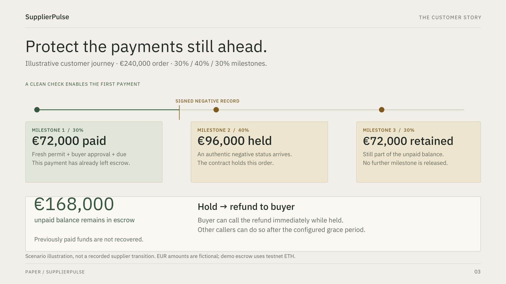

# SupplierPulse — pitch pipeline designs

Three original, editable diagrams in the selected Paper visual language. All slide copy is English; the comparison page includes English presenter notes. These are conceptual product-flow diagrams, not screenshots of live settlement.

Open `index.html` locally to compare the designs. No build or network connection is needed to view them. Each diagram has a self-contained SVG with embedded fonts and a 1920 × 1080 PNG suitable for slides.

| Design | Suggested use | Files |
|---|---|---|
| The payment gate | Main pitch: how the product works, in about 20 seconds | [PNG](payment-gate.png) · [SVG](payment-gate.svg) |
| Evidence and settlement | Technical explanation / judge Q&A: source, signer, agent, contract and the two payment rails | [PNG](evidence-and-settlement.png) · [SVG](evidence-and-settlement.svg) |
| The milestone story | Customer value: what remains protected after a previous installment was paid | [PNG](milestone-story.png) · [SVG](milestone-story.svg) |

Recommendation: use **The payment gate** as the main flow slide. Use the milestone story beside the customer problem or before the demo. Keep evidence and settlement as the technical backup. Avoid presenting all three consecutively in a 150-second video.

## Previews

### The payment gate

### Evidence and settlement

### The milestone story

## Meaning preserved

- The source is Companies House or GLEIF; the configured API3 Airnode signs the response, and the agent submits it.
- Authentication and order-policy evaluation are distinct. An invalid submission is rejected; a valid negative record can hold an order.
- Clean evidence creates a permit for one next milestone. Release also requires buyer approval, the due date and no newer disqualifying supplier failure. Permits expire and are consumed.
- A held order can be refunded by its buyer immediately; another caller must wait for the grace period. A refund is a call, not an automatic consequence of rejecting a forged submission.
- The x402 data purchase uses aUSD on Base Sepolia. The supplier escrow contract is on Ethereum Sepolia and pays testnet ETH. These are separate transactions.
- The €240,000, 30/40/30 story is fictional: €72,000 paid leaves €168,000 unpaid. It does not establish a real supplier transition in demo order B, a EUR/stablecoin deployment or recovery of previously paid funds.
- This is the core payment pipeline, not an exhaustive feature map. Document commitments, history tiers, no-data exit and the verification lab can be covered in their own detail/demo scenes.

## Source basis and limits

Checked against the local source snapshot based on `main` at `843ddad`: `api3/src/SupplierPulsePlus.sol` (`submitEvidence`, `_verify`, `_apply`, `release`, `refundRemaining`) and `docs/SUPPLIERPULSE_PLUS.md`. The fictional order amounts match the existing local example pitch packet. Paper styling matches branch `codex/control-room-paper`, commit `18cf006`.

Published on `codex/pitch-pipeline-designs`. No paid fetch, live verification, signing, settlement, application edit, existing pitch edit or deployment was performed for this design package.

## Editing and export

- Use the SVG for sharp scaling; use the PNG when slide software cannot preserve embedded SVG fonts.
- The bundled IBM Plex Sans files are licensed under SIL OFL; see `fonts/OFL.txt` and the download-source manifest.
- `build.py` contains the editable diagram geometry and copy. Rebuild with Python 3 and Pillow: `python3 build.py`. No API calls are used.
- Validation: all SVGs parse as XML, all three PNGs are 1920 × 1080, 71 text-width checks pass, gallery asset links and JavaScript syntax pass. All three gallery tabs were checked in a desktop browser with loaded images and no page-level horizontal overflow. PNGs were visually inspected. Mobile slide readability and a physical projector were not tested.
