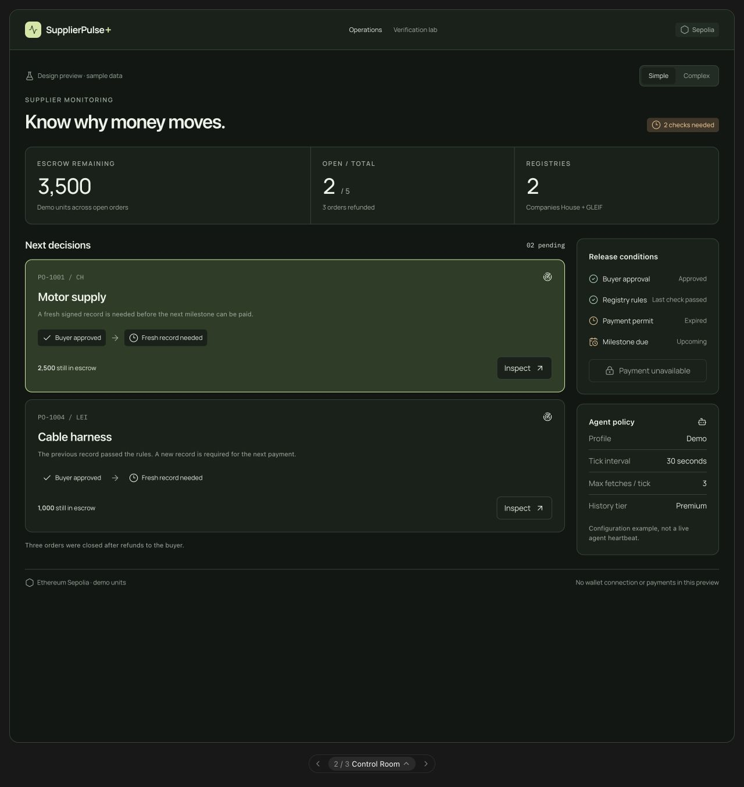
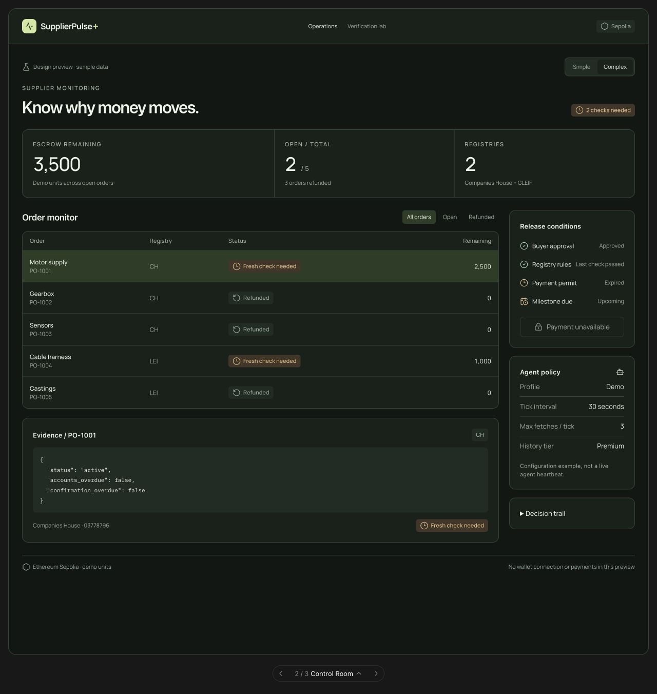

# Control Room — uygulama için tasarım tarifi

Durum: Orhun ve ekibin beğendiği iki yönden biri. Amaç ajan kararlarını ve fon hareketini anlaşılır bir operasyon ekranında göstermek. Görseller çalışan önizlemeden alınmıştır; bir canlı ajan veya güncel zincir durumu kanıtı değildir.

Önce [ortak kuralları](SHARED_REQUIREMENTS.md) oku. Finans odaklı alternatif [Ledger](LEDGER.md), ortak yön [Ledger + Control Room](LEDGER_CONTROL_ROOM.md).

## Simple görünümü



## Complex görünümü



## Tasarımın amacı

Kullanıcıya “ajan hangi işi takip ediyor, sıradaki ödeme neden bekliyor, bunu hangi kanıt açıklıyor?” sorularının cevaplarını ver. Teknik bir kontrol odası hissi olsun; okunaksız terminal veya sahte canlı telemetri duvarı olmasın.

## Ekran yapısı

```text
SupplierPulse+       Operations / Verification lab       Sepolia
Veri modu                                       Simple / Complex
Supplier monitoring
Know why money moves.                           Kontrol ihtiyacı
Escrow remaining          Open / total           Registries

Next decisions / Order monitor                 Release conditions
İlgili siparişler                               Buyer approval
                                               Registry rules
[Complex: seçili sipariş kanıtı]                Payment permit
                                               Milestone due
                                               Agent policy
                                               [Decision trail]
Ağ, birim ve veri kaynağı
```

- Sol sabit menü yerine yatay ürün navigasyonu kullan.
- Üst navigasyon alt çizgiyle ana alandan ayrılır.
- İç yatay boşluk yaklaşık 26 px; ana kolonlar arasında 20 px.
- Sağ kontrol kolonu yaklaşık 245 px, sol taraf esnektir.
- Üç metrik ortak bir şerit içinde görünür. Ekranı bağımsız KPI kutuları ile doldurma.
- Bekleyen karar kartında PO/registry, sipariş adı, neden, kısa koşul zinciri, kalan escrow ve Inspect aksiyonu bulunur.
- Seçili kart/row hafif yeşil yüzeyle ayrılır.

## Tipografi ve renkler

| Rol | Tarif |
| --- | --- |
| Genel arayüz | Manrope, yaklaşık 13–14 px |
| Büyük başlık | Manrope 600, yaklaşık 33 px; sıkı fakat okunaklı harf aralığı |
| Metrik | Manrope 500, yaklaşık 37 px; tabular rakamlar |
| PO / ham veri | IBM Plex Mono, 11–12 px |
| Sayfa | Açık `#edf0eb`, koyu `#111714` |
| Panel | Açık `#f9fbf8`, koyu `#18211b` |
| Ana yazı | Açık `#203025`, koyu `#edf3e9` |
| İkincil yazı | Açık `#596c5d`, koyu `#9eafa1` |
| Çizgi | Açık `#cdd7ca`, koyu `#344337` |
| Vurgu | Açık `#345a35`, koyu `#d0e8a0` |
| Seçili yüzey | Açık `#e1ebd8`, koyu `#2c3c25` |

Yeşil kimlik rengidir; her yeşil eleman “şirket güvenilir” anlamına gelmez. Bekleme amber, reddedilme kırmızı, tamamlanmış iade nötr durum metniyle gösterilir. Renge mutlaka metin ve gerektiğinde simge eşlik eder.

## Simple ve Complex farkı

| Bölüm | Simple | Complex |
| --- | --- | --- |
| Ana iş alanı | İlgilenilmesi gereken siparişler / Next decisions | Tüm siparişleri içeren filtreli Order monitor |
| Seçili sipariş | Sade neden ve okunabilir koşullar | Kaynak kimliği ve kanıt alanlarıyla ayrıntılı inceleme |
| Release conditions | Dört koşul görünür | Aynı koşullar görünür; daha fazla kanıt açılır |
| Agent policy | Önizlemede kısa yapılandırma bilgisi | Ayrıntılar ve karar geçmişi incelenebilir |
| Decision trail | Gizli | Açılabilir; gerçek uygulamada event/ajan kayıtlarına dayanır |
| Ham veri | Gizli | Orijinal alanlar ve doğrulama bağlamı gösterilebilir |

Simple üretim sürümünde ajan politikasını disclosure içine almak uygundur. Ödeme için belirleyici dört koşul ise iki modda da görünür kalmalı.

## Ödeme koşulları paneli

Her satır ayrı veri kaynağından türetilir:

1. **Buyer approval:** ilgili milestone gerçekten onaylandı mı?
2. **Registry rules:** en son kabul edilmiş kayıt hangi kuralları geçti veya ihlal etti? Tarihî bir başarılı kontrol güncel izin anlamına gelmez.
3. **Payment permit:** mevcut milestone için geçerli izin var mı, ne zaman bitiyor?
4. **Milestone due:** zaman geldi mi? Kalan süreyi okunur göster; negatif sayaç bırakma.

Aktif order ve güncel supplier stop kontrolü de aksiyonu etkiler. Dört satırın olumlu görünmesi tek başına release düğmesini açmak için yeterli kabul edilmemeli; mevcut sözleşme/uygulama kontrolleri korunur.

Ödeme kullanılamıyorsa düğme pasif, neden metni görünür olsun. Salt “disabled” durumuna güvenme. Tx gönderildiyse bekleme, başarılı makbuz veya hata durumunu ayrı göster.

## Ajan ve geçmiş

- Önizleme değerleri yapılandırma örneğidir: tick 30 s, tick başına en çok 3 fetch. Üretimde gerçek config’i oku.
- Heartbeat veya son çalışma kaydı alınamıyorsa “Not connected / Unknown” göster. Hareketli yeşil noktayla çalışıyormuş gibi yapma.
- Bütçe, harcama ve x402 fiyatı gösterilecekse gerçek kayıt ve birim kullan. Üst fiyat sınırını gerçekleşen harcamayla karıştırma.
- History tier kontrol sıklığı içindir; kredi skoru, ödeme garantisi veya uzun süreli sicil onayı değildir.
- Karar geçmişinde fonlama, kanıt kabulü, permit verilmesi, ödeme, hold ve iade ayrı olaylardır. Olmayan bir event üretme.

## Etkileşim ve mobil

- Inspect seçili siparişi değiştirir; sağ koşullar ve kanıt aynı order’a ait olmalı.
- Filtreler kayıt listesini değiştirir. Kullanıcı başka supplier’a ait eski ayrıntıları seçili sanmamalı.
- Verification lab ayrı çalışma alanıdır; gerçek doğrulama akışı [ortak kurallardaki](SHARED_REQUIREMENTS.md) gibi korunur.
- 900 px altında sağ kolon alta geçer; mümkünse iki kısa panel yan yana kalabilir.
- Dar telefonda tüm paneller tek kolon; navigasyon ve metrik başlıkları sarılabilir.
- Tablo taşması tablo içinde kalır. Hash/LEI satırları sarılır veya tam değer erişilebilir biçimde kısaltılır.

## Kabul ölçütü

Ekrandaki her kararın nedeni ve veri kaynağı anlaşılabilmeli. Mevcut veriyle kanıtlanamayan ajan çalışması veya ödeme durumu uydurulmamalı. Simple anlaşılır olmalı; Complex aynı ürünün ayrıntılı incelemesi gibi hissettirmeli.

Kaynak: [seçili tasarım önizlemesi](supplierpulse-selected-designs.html), `control(s)` ve `.sp-control*` stilleri. Görsel ilham: [Linear](https://linear.app/).
