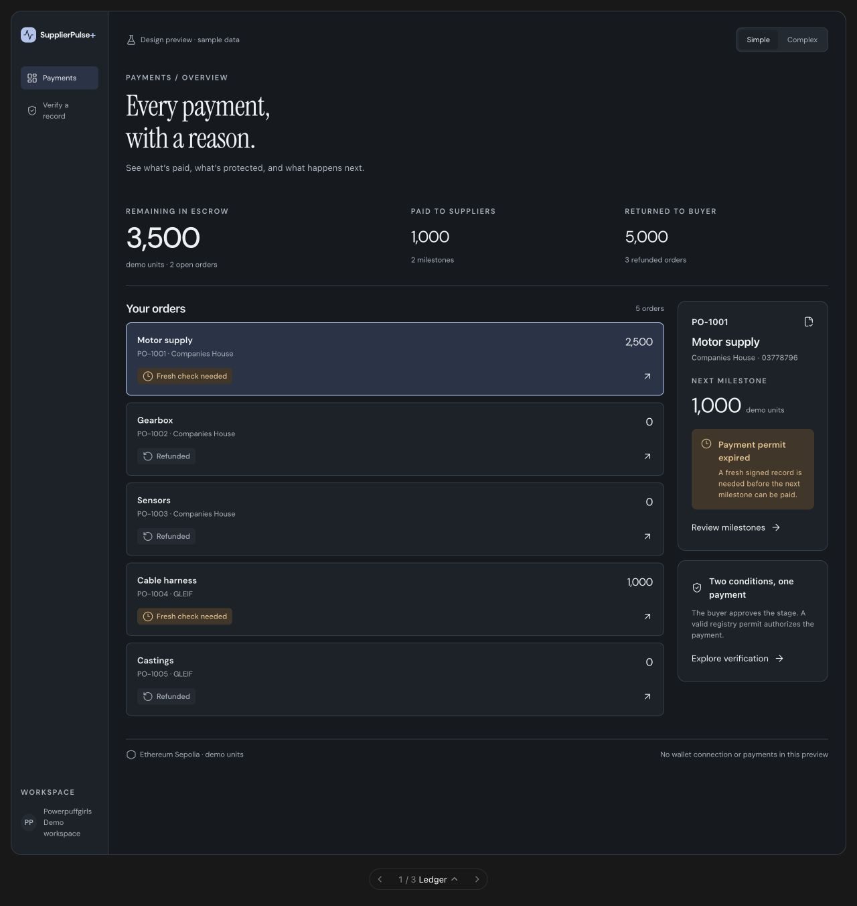
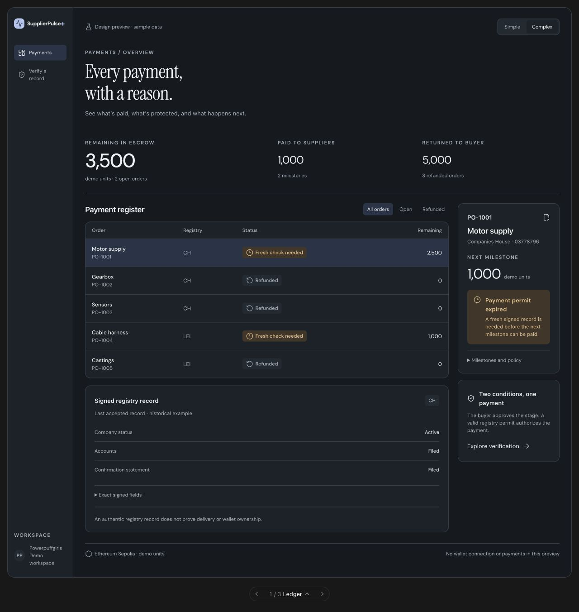

# Ledger — uygulama için tasarım tarifi

Durum: Orhun ve ekibin beğendiği iki yönden biri. Bu belge, başka bir AI’ın tasarımı gerçek SupplierPulse+ arayüzüne uygulaması içindir. Görseller çalışan tasarım önizlemesinden alınmıştır; içlerindeki tutarlar ve durumlar örnektir.

Önce [ortak ürün ve entegrasyon kurallarını](SHARED_REQUIREMENTS.md) oku. Birleşik versiyon için [Ledger + Control Room](LEDGER_CONTROL_ROOM.md) belgesine bak.

## Simple görünümü



## Complex görünümü



## Tasarımın amacı

İlk bakışta üç soruyu cevapla: Ne kadar para escrow’da? Hangi siparişte ne oldu? Sıradaki ödeme neden bekliyor?

Sakin, kurumsal bir finans ürünü hissi ver. Büyük tipografi, geniş boşluk ve az sayıda vurgu kullan. Terminal, kripto alım satım ekranı veya pazarlama landing page’i görünümüne dönüştürme.

## Ekran yapısı

```text
Sol menü     Ana alan
             Üst satır: veri modu                  Simple / Complex
Payments     Every payment,
Verify       with a reason.
             Kalan escrow       Ödenen       İade edilen
Workspace    Siparişler / ödeme tablosu      Seçili sipariş
             [Complex: sicil kanıtı]         Sonraki aşama / neden
                                            Ödeme mantığı açıklaması
             Ağ, birim ve veri kaynağı bilgisi
```

- Masaüstünde sol menü yaklaşık 145 px; ana içerik kalan alanı kullanır.
- Ana içerik yatay boşluğu yaklaşık 26 px, iç kolon aralığı 20 px.
- Sipariş detay kolonu yaklaşık 225 px. Liste/tablo kolonu esnektir; `min-width: 0` gerekir.
- Başlık sola hizalıdır; “Every payment, with a reason.” iki satırdır.
- Escrow tutarı en güçlü sayıdır. Ödenen ve iade edilen tutarlar aynı satırda daha küçük gösterilir.
- Alt durum bilgisi içerik akışındadır. Ekrana sabitlenmiş, içeriği örten footer kullanma.
- Görsellerdeki büyük boş alanlar önizleme sahnesinden kaynaklanabilir; gerçek uygulamada yüksekliği içeriğe göre belirle.

## Tipografi ve renkler

| Rol | Tarif |
| --- | --- |
| Büyük başlık | Instrument Serif, normal, yaklaşık 43 px masaüstü / 36 px dar ekran |
| Arayüz | DM Sans, 13–14 px; başlıklarda 500–600 ağırlık |
| Kimlik, hash, teknik alan | IBM Plex Mono, okunaklı 11–12 px |
| Para | Tabular rakamlar; escrow yaklaşık 43 px, diğer toplamlar yaklaşık 24 px |
| Sayfa | Açık `#f7f7f3`, koyu `#15191e` |
| Panel | Açık `#ffffff`, koyu `#1c2229` |
| Ana yazı | Açık `#222b32`, koyu `#eff1f2` |
| İkincil yazı | Açık `#626b72`, koyu `#a8b2bd` |
| Çizgi | Açık `#dedfd8`, koyu `#343d47` |
| Vurgu | Açık `#344b70`, koyu `#afc4ed`; seçili yüzey `#eaf0f8` / `#273448` |

Panel köşeleri yaklaşık 12 px, butonlar 7–8 px. İnce çizgiler kullan; ağır gölgeler, neon ışıklar, sürekli animasyonlar ekleme. Simgeler küçük Lucide simgeleridir; anlam yalnızca renge bağlı değildir.

## Simple ve Complex farkı

| Bölüm | Simple | Complex |
| --- | --- | --- |
| Finans özeti | Üç toplam | Aynı üç toplam |
| Sipariş seçimi | İsim, PO, kalan tutar ve durum içeren kartlar | Order / Registry / Status / Remaining tablosu |
| Filtre | Varsayılan tüm siparişler | All orders / Open / Refunded |
| Sağ detay | Sonraki aşama veya iade tutarı; sade neden | Aynı bilgi + açılabilir Milestones and policy |
| Sicil kanıtı | Teknik alanlar gizli | Seçili siparişin son kabul edilmiş alanları; ham veri açılabilir |
| Teknik inceleme | Review milestones düğmesi Complex’e geçirir | Veri yaşı, izin süresi ve geçmiş katmanı gerektiğinde görünür |

## Etkileşimler

1. Sipariş seçimi sağ paneli ve sicil kanıtını aynı siparişe günceller. Seçim değiştiğinde bir önceki siparişin kanıtını ekranda bırakma.
2. Mod değişince seçili sipariş korunur. Filtrenin sıfırlanması gerekiyorsa tutarlı davran; finans toplamlarını sessizce filtre toplamlarına dönüştürme.
3. İade edilmiş siparişte “Next milestone” yerine “Returned to buyer” göster. Yeniden ödeme yapılabileceğini ima etme.
4. “Review milestones” Complex’i açar. “Explore verification” doğrulama ekranına gider.
5. “Exact signed fields” bir disclosure’dır. Açılınca orijinal veri gösterilir; hash veya imzalı baytlar yeniden yazılmaz.
6. Gerçek ödeme yapılabilecek bir aşama varsa aksiyon, mevcut uygulamanın yetki ve cüzdan akışına bağlanır. Önizlemedeki örnek durumlar üretimde kullanılmaz.

## Dar ekran

- Yaklaşık 900 px altında sağ panel liste/tablonun altına geçer.
- 620 px altında sol menü üst navigasyona dönüşür; çalışma alanı dip bloğu kaldırılabilir.
- 390 px altında yan yana detay panelleri tek kolona iner.
- Tablo taşarsa yalnızca tablo kapsayıcısı yatay kayabilir; bütün sayfa taşmamalı.
- Sağdaki neden açıklaması ve aksiyonlar mobilde kaybolmamalı.
- Native buton ve klavye odağı kullan. Dokunma hedeflerini yaklaşık 44 px yap; temel açıklamaları küçük puntolarla sıkıştırma.

## Kabul ölçütü

Görseldeki sakin hiyerarşiyi korurken gerçek aktif, bekleyen, durdurulan, süresi dolan ve iade edilmiş durumları doğru göster. Kullanıcı escrow, ödeme ve iadeyi birbirine karıştırmadan okuyabilmeli. Simple görünüm teknik bilgileri azaltmalı, ödeme yapılabilirliğini etkileyen nedeni gizlememeli.

Referans kaynak: [seçili tasarımların düzenlenebilir önizlemesi](supplierpulse-selected-designs.html), `ledger(s)` fonksiyonu ve `.sp-ledger*` stilleri. Görsel ilham: [Mercury demo](https://demo.mercury.com/dashboard); üçüncü taraf marka veya varlıklarını kopyalama.
