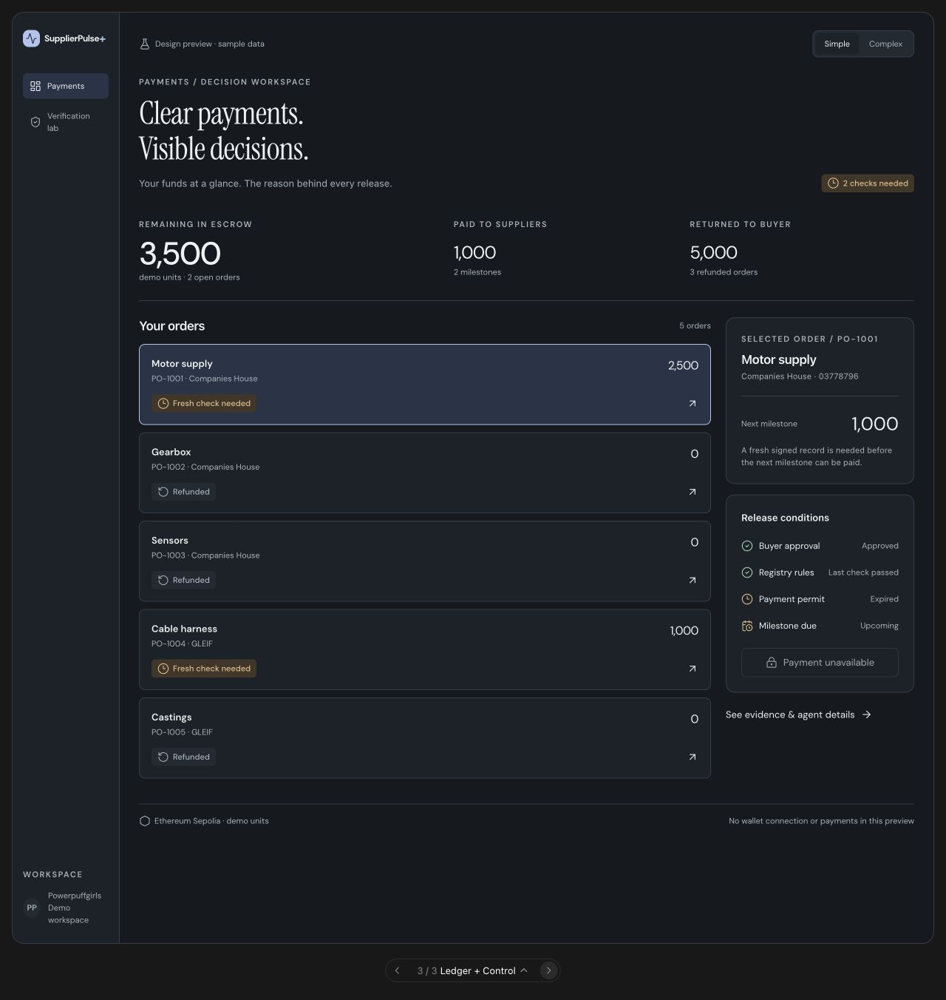
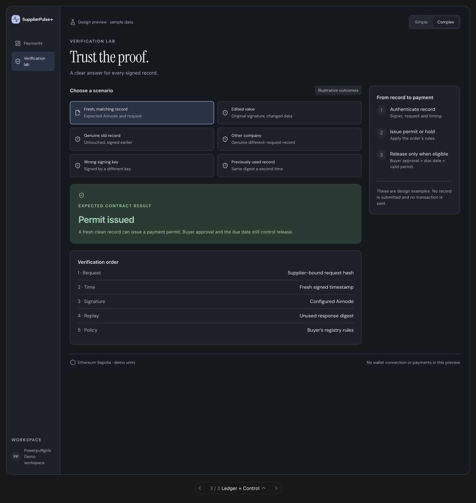
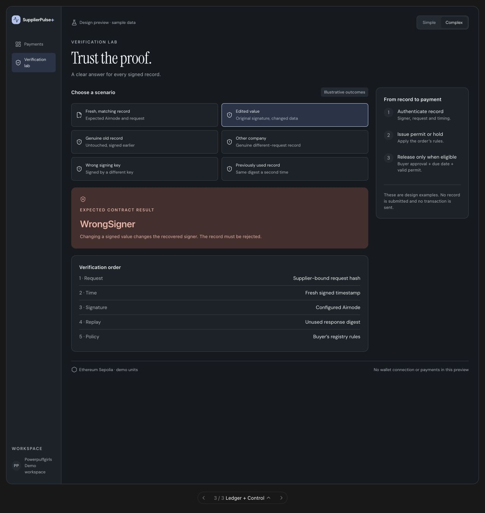

# Ledger + Control Room — birleşik tasarım

Bu yön, Orhun’un “Ledger ve Control Room’u combine et” isteği üzerine hazırlandı. İki tasarımın beğenilmesi kullanıcı tarafından doğrulandı; birleşik tasarımın nihai üretim seçimi olduğu henüz doğrulanmadı. Başka AI’a uygulanabilir bir üçüncü seçenek olarak verilebilir.

**Temel fikir:** Ledger’ın sakin finans ekranı + Control Room’un karar şeffaflığı. Kullanıcı aynı yerde hem parasını hem de ödemenin neden ilerleyemediğini görür.

## Simple görünümü



## Complex görünümü


## Ne nereden alındı?

| Karar | Kaynak | Birleşik ekrandaki karşılığı |
| --- | --- | --- |
| Sol ürün menüsü | Ledger | Payments / Verification lab; tek navigasyon |
| Tipografi | Ledger | Serif ana başlık, sade DM Sans arayüz |
| Finans özeti | Ledger | Escrow / Paid / Returned; bir kez gösterilir |
| Sipariş kartları | Ledger | Simple modun ana listesi |
| İzleme tablosu | Control Room | Complex modda Order monitor ve filtreler |
| Ödeme koşulları | Control Room | Seçili order’a ait sağ panel; Simple’da da görünür |
| Sicil kanıtı | İki yönün ortak mantığı | Complex modda tablo altında; ham veri disclosure’da |
| Ajan politikası | Control Room | Complex sağ panelde açılabilir |
| Karar geçmişi | Control Room | Complex ana kolonda açılabilir |
| Görsel dil | Ledger tabanı | Lacivert seçili yüzey, gerçek anlam taşıyan durum renkleri |

Control Room’un yatay menüsünü ayrıca ekleme; Ledger’ın yan menüsüyle çakışmasın. Finans özetini bir de “agent stats” başlığıyla tekrar etme. İki ayrı dashboard’u alt alta birleştirme.

## Ekran iskeleti

```text
145 px menü | Finans ve karar çalışma alanı
             Veri modu                              Simple / Complex
Payments     Clear payments.
Verification Visible decisions.
             Kısa açıklama                         Kontrol ihtiyacı
             Escrow              Paid              Returned
             ──────────────────────────────────────────────
             Sipariş listesi / Order monitor       Selected order
             [Simple: 5 seçim kartı]               Sonraki aşama/tutar
             [Complex: filtreli tablo]             Sade neden
                                                   Release conditions
             [Complex: signed registry record]     Buyer approval
             [Complex: decision trail]             Registry rules
                                                   Payment permit
                                                   Milestone due
                                                   Aksiyon
                                                   [Complex: Agent policy]
             Ağ ve veri kaynağı
```

Masaüstünde ana alan `minmax(0, 1fr) 255px`, kolon aralığı yaklaşık 20 px. Sol menü 145 px, ana padding yaklaşık 26 px. 1024 px civarında tablo okunurluğu bozulursa sağ paneli alta taşı; yazıyı küçülterek sığdırma.

## Görsel özellikler

- [Ledger renk ve tipografi tablosunu](LEDGER.md#tipografi-ve-renkler) temel al.
- Ana başlık Instrument Serif 43 px civarıdır; arayüz DM Sans, teknik alan IBM Plex Mono.
- Sayılar tabular; para birimleri açık yazılır. Preview’daki “demo units” gerçek fiat para değildir.
- Sağdaki selected-order paneli ile release paneli aynı genişliktedir.
- Eylem nedeni, JSON’dan önce gelir. “Expired” etiketinin yanında ne gerektiği yazılır.
- Yeşil yalnızca karşılanan koşullarda; amber bekleme/eskime, kırmızı doğrulama reddi/politika ihlali, nötr iade için kullanılır.
- İnce çizgi, 12 px panel köşesi ve geniş boşluk kullan. Ekrana grafik eklemek zorunlu değildir; bu ürünün asıl bilgisi kanıt ve karardır.

## Simple davranışı

1. Üç finans toplamı ve sade sipariş kartları görünür.
2. Bir order seçildiğinde sağda sipariş adı, registry kimliği, sıradaki tutar ve neden güncellenir.
3. Açık siparişte dört ödeme koşulu insan diliyle görünür. Teknik hashler veya imza ayrıntıları bu görünümü doldurmaz.
4. “See evidence & agent details” Complex’e geçirir; aynı order seçili kalır.
5. İade edilmiş order seçildiğinde “Returned to buyer” ve iade tutarı gösterilir. Ödeme koşulları yerine “Refund complete” görünür.
6. Kullanıcı nedeni görmek için Complex’e geçmek zorunda kalmaz.

## Complex davranışı

1. Kartların yerini Order monitor tablosu alır; All orders / Open / Refunded filtreleri eklenir.
2. Seçili order’ın kaynak alanları tablonun altında gösterilir. Tarihî veriye “Last accepted record” etiketi konur.
3. Ham veri, request hash, signer/digest gibi teknik ayrıntılar gerektiğinde açılır. Bunların üretim veri eşlemesi [ortak belgede](SHARED_REQUIREMENTS.md) tanımlıdır.
4. Sağ panelde koşullar korunur. Agent & permit policy açılarak config ve order’a ait izin parametreleri incelenir.
5. Decision trail eventlere veya güvenilir yerel ajan kaydına bağlıdır. Her satırın zamanı ve kaynağı ayrıdır.
6. Simple/Complex değişimi gerçek işlemi veya ajan çalışmasını tetiklemez; yalnızca bilgi yoğunluğunu değiştirir.

## Doğrulama ekranı





Önizlemede senaryo seçimleri yereldir ve **beklenen sonucu** gösterir. Gerçek üründe bu örnek panel, çalışan judge akışının yerini alamaz. Şu iki bağlam açıkça ayrılmalı:

- **Örnek senaryo:** Sabit veriyle öğrenme; “Illustrative / Sample” etiketi, işlem yok.
- **Gerçek doğrulama:** Kullanıcının kendi signed response’unu mevcut doğrulayıcıya vermesi; gerçek signer/request/time/policy sonucu ve varsa tx makbuzu.

Geçerli temiz kanıt “Permit issued” üretebilir; “Payment completed” ancak ödeme makbuzu/eventi varsa gösterilir. Daha eski veya farklı şirkete ait gerçek signed response testleri, imza/timestamp alanını değiştirerek taklit edilmemeli.

## Önerilen bileşen sınırları

```text
AppShell
  ProductNavigation
  DataModeIndicator + DensityToggle
  FinancialSummary
  OrderWorkspace
    OrderCards | OrderMonitor
    OrderDecisionPanel
      SelectedOrderSummary
      ReleaseConditionList | RefundSummary
      AgentPolicyDisclosure
    RegistryEvidencePanel
    DecisionTrailDisclosure
  VerificationWorkspace
  NetworkAndDataFooter
```

Bu bir mimari tariftir; React zorunluluğu değildir. Mevcut statik HTML/ethers kodu korunarak aynı parçalar fonksiyonlar olarak uygulanabilir. Tasarım önizlemesinde `hybrid(s)`, `.sp-hybrid*` ve ortak Ledger/Control yardımcıları bu yapıyı gösterir.

## Üretime geçişte gerekli uyarlamalar

- Preview’daki sabit toplamları, `Upcoming`, `Approved`, `Expired` etiketlerini gerçek durumdan türet.
- Panelde demo sayısı veya metin sabitlemek yerine mevcut order, milestone, supplier ve event verilerini bağla.
- Supplier toparlanmışsa yalnızca eski failure zamanı bulunduğu için hâlâ stopped yazma. Yeni UI, ekipteki recovery düzeltmesini kaybetmemeli.
- Ajan politikasını canlı heartbeat gibi sunma. Bağlantı veya kayıt yoksa bunu açıkça göster.
- Hash/salt özelliği mevcut hedef branch’te varsa metadata alanında göster; yoksa yeni kontrat API’si icat etme. Belge bütünlüğü, teslimat ve yasal imza ayrı konulardır.
- Bekleme, boş veri, RPC hatası, yanlış ağ, cüzdan bağlantısızlığı ve işlem reddi tasarlanmalıdır.
- 320/390/768/1024/1440 px, açık/koyu tema ve klavye kontrolü uygulanmış ürün üzerinde doğrulanmalıdır. Önizleme ekran yüksekliğini üretimde sabitleme.

## Diğer AI’a verilecek kısa yönlendirme

“Ledger’ın finans hiyerarşisi ve sol menüsünü koru. Control Room’un seçili siparişe bağlı ödeme koşullarını ekle. Simple’da karar nedenini sade göster; Complex’te aynı order’ın kanıtı, ajan politikası ve event geçmişini aç. İki dashboard’u bir araya yığma. Mevcut kontrat/ABI ve doğrulama akışlarını koru. Bu belgedeki görselleri ve SHARED_REQUIREMENTS.md dosyasını birlikte uygula.”

Tam kopyalanabilir görev: [IMPLEMENTATION_PROMPT.md](IMPLEMENTATION_PROMPT.md).
