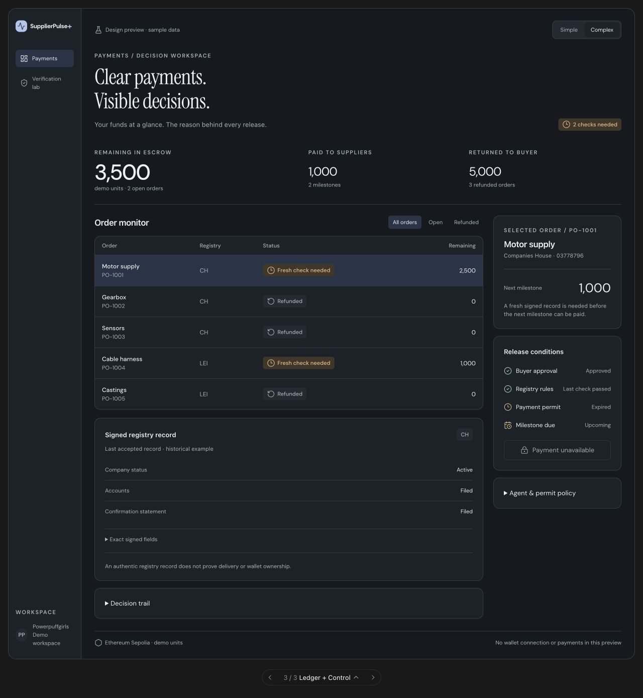

# SupplierPulse+ — UI tasarım devir paketi

Orhun ve ekip **Ledger** ile **Control Room** yönlerini beğendi. Bu paket iki yönü ayrı tarif eder ve istek üzerine birleştirilmiş üçüncü bir öneri sunar. Her yönde **Simple / Complex** görünüm vardır. Gerçek uygulama başka bir AI tarafından hazırlanacaktır; bu branch tasarım, görsel referans ve uygulama görevi içerir.

## Nereden başlamalı?

| Dosya | İçerik |
| --- | --- |
| [LEDGER.md](LEDGER.md) | Finans odaklı tasarım; iki ekran görüntüsü, renkler, ölçüler ve etkileşimler |
| [CONTROL_ROOM.md](CONTROL_ROOM.md) | Ajan/karar odaklı tasarım; iki görüntü ve davranış tarifi |
| [LEDGER_CONTROL_ROOM.md](LEDGER_CONTROL_ROOM.md) | İki yönün birleşimi; iki ana görünüm ve iki doğrulama görüntüsü |
| [SHARED_REQUIREMENTS.md](SHARED_REQUIREMENTS.md) | Gerçek kod/veri eşlemesi, ürün doğruluğu ve kabul kontrolleri |
| [IMPLEMENTATION_PROMPT.md](IMPLEMENTATION_PROMPT.md) | Diğer AI’a doğrudan kopyalanacak uygulama görevi |
| [Ekran görüntüleri](screenshots/README.md) | Sekiz JPEG’nin listesi ve yakalama bilgisi |
| [preview.html](preview.html) | Tarayıcıda açılabilen üç yönlü etkileşimli önizleme |
| [supplierpulse-selected-designs.html](supplierpulse-selected-designs.html) | Üç seçeneğin düzenlenebilir tasarım kaynağı |

Birleşik yönü geliştirecek AI’a **IMPLEMENTATION_PROMPT.md + LEDGER_CONTROL_ROOM.md + SHARED_REQUIREMENTS.md** ve referans JPEG’leri ver. Depoya erişimi yoksa klasörü dosyalarıyla birlikte paylaş; Markdown içindeki resim yolları JPEG’ler olmadan çalışmaz.

## Kısa karşılaştırma

| Yön | Ana fikir | Simple | Complex |
| --- | --- | --- | --- |
| Ledger | Parayı ve siparişi hızlı anla | Finans özeti, kartlar, sade neden | Tablo, kanıt, açılabilir milestone/politika |
| Control Room | Ajan kararını takip et | Bekleyen işler ve koşul listesi | Order monitor, imzalı alanlar, ajan ve geçmiş |
| Ledger + Control | Finans hiyerarşisi + karar şeffaflığı | Ledger listesi ve Control Room koşulları | Aynı bağlamda tablo, kanıt ve operasyon ayrıntıları |

## Kaynak ve kapsam

- Branch: `codex/ui-design-concepts`.
- Güncel hazırlık tabanı: `main` / `56cbd27`. İlk üç tasarım `dc719f6` tabanında hazırlanmıştı.
- UI referansı: `batu/plus-ui` / `3c6b44c`. Diğer yeni feature branch’ler ve recovery ayrımı ortak gereksinim belgesinde işaretlidir; bu paket bunları merge etmez.
- `supplierpulse-ui-concepts.html` önceki üç yönlü keşfi, Agreement dahil, tarihî tasarım kaynağı olarak korur. Güncel devir için **supplierpulse-selected-designs.html** kullan; Agreement seçilen kapsamda değildir.
- Uygulama dosyaları, kontrat, ABI, ajan, bağımlılıklar ve deployment bu pakette değiştirilmedi. Bu bir tasarım teslimidir; çalışan üretim entegrasyonu değildir.

## Önizleme nasıl açılır?

`preview.html` dosyasını klonladıktan/indirdikten sonra tarayıcıda aç. Alttaki seçiciden Ledger, Control Room veya Ledger + Control yönüne geç; ürün içindeki Simple/Complex düğmelerini ve siparişleri dene.

Dosya, yerel örnek verili ve sandbox içinde çalışan tasarım önizlemesidir. İkon/font kaynakları için internet gerekebilir. Uygulama RPC’sine, ücretli API’ye veya cüzdana bağlanmaz. Çevrimdışı görsel referans için JPEG’leri kullan. Bu dosyayı gerçek dashboard veya judge ekranıyla değiştirme.

## Kontroller

- JavaScript sözdizimi, Markdown/görsel yolları ve JPEG dosyaları doğrulandı.
- Üç tasarımın Simple/Complex geçişleri ve yerel doğrulama örnekleri tarayıcıda kontrol edildi.
- Görseller canlı önizlemeden alındı; görüntü üretim aracıyla oluşturulmadı ve içerikleri sonradan değiştirilmedi.
- Orijinal Ledger/Control Room tasarımlarının 320 px yerleşim kontrolü önceki hazırlıkta yapıldı. Birleşik önizlemenin Simple/Complex görünümü aynı dar ekran CSS kuralları uygulanmış 320 px fixture ile taşma açısından kontrol edildi; tüm gerçek cihaz ve üretim entegrasyon testleri uygulama aşamasında tekrar yapılmalıdır.
- Ekranlarda görülen tutarlar ve zaman durumları örnektir. Son zincir durumunu veya ajanın çalıştığını kanıtlamaz.

## Görsel ilham

[Mercury demo](https://demo.mercury.com/dashboard) finans hiyerarşisi; [Linear](https://linear.app/) operasyon düzeni ve bilgi yoğunluğu için referans alındı. İlk keşifte [Ramp bill lifecycle](https://support.ramp.com/bill-lifecycle/) de incelendi. Üçüncü taraf UI kodu, marka veya ekran görüntüleri bu tasarımlara kopyalanmadı.
