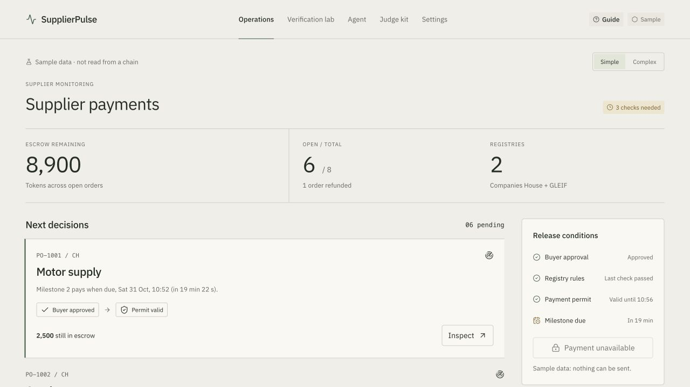
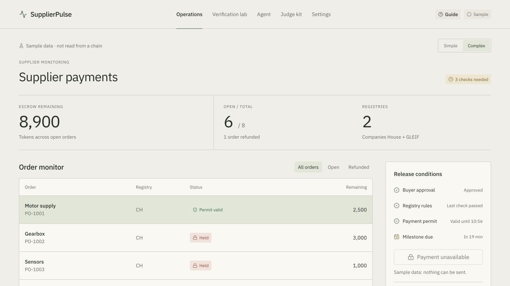
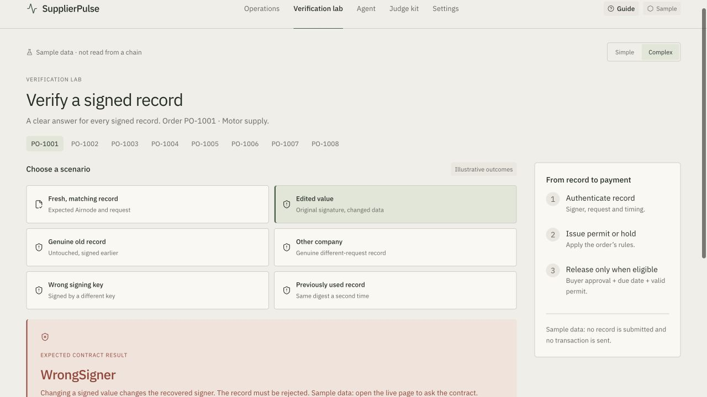

# Control Room — Paper

Selected by Orhun on 31 October 2026. Implemented on top of `main` at `843ddad`.

This is the real Control Room with the selected visual treatment, rather than the bundled design-review prototype. Live data remains the default; `?sample=1` explicitly selects illustrative data. Simple and Complex views remain available on all five screens.

## Visual changes

- Warm paper background (`#f1eee7`), off-white panels and restrained forest-green accents.
- Locally hosted IBM Plex Sans, lighter headings and plain page titles.
- Flatter order rows, smaller corner radii and rules instead of oversized card outlines.
- Matching verification states, keyboard focus indicators and Guide styling.
- Paper is intentionally a light theme, independent of the operating system's appearance.

Presentation overrides live in [`demo/control-paper.css`](../../../demo/control-paper.css). The existing layout rules remain in `control.html` to keep the integration small. The former remote Google Fonts import is removed for this page. Font weights 400, 500 and 600 are bundled under the [SIL Open Font License](../../../demo/fonts/ibm-plex-sans/OFL.txt); the [font manifest](../../../demo/fonts/ibm-plex-sans/manifest.json) records the original download URLs.

## Preview

From the repository root:

```sh
python3 -m http.server 8765 --bind 127.0.0.1 --directory demo
```

Open `http://localhost:8765/control.html?sample=1`. To use live data, remove `?sample=1`; the existing contract/RPC parameters still work.

These screenshots were captured from the integrated page at a 1280 × 720 browser viewport. All values and verdicts shown are **sample data**, not evidence of a live transaction.

### Operations — Simple



### Operations — Complex



### Verification lab



## Validation

- Navigated Operations, Verification lab, Agent, Judge kit and Settings in both Simple and Complex: 10 combinations rendered without document-level horizontal overflow at 1280 px.
- Checked that IBM Plex Sans loaded and the computed page background matched Paper.
- Checked the illustrative edited-value rejection and the Guide dialog.
- Parsed every inline JavaScript block with `node --check`.
- Compared inline scripts with the base: identical after normalizing the five heading strings. Data loading, transaction handlers and verifier behavior are unchanged.
- `git diff --check` passed.

This pass does not revalidate the contract or the live payment/tamper workflow. No wallet was connected, no paid data was fetched, and no transaction was submitted. Pitch, contracts, dependencies and other dashboard pages are outside this change.
